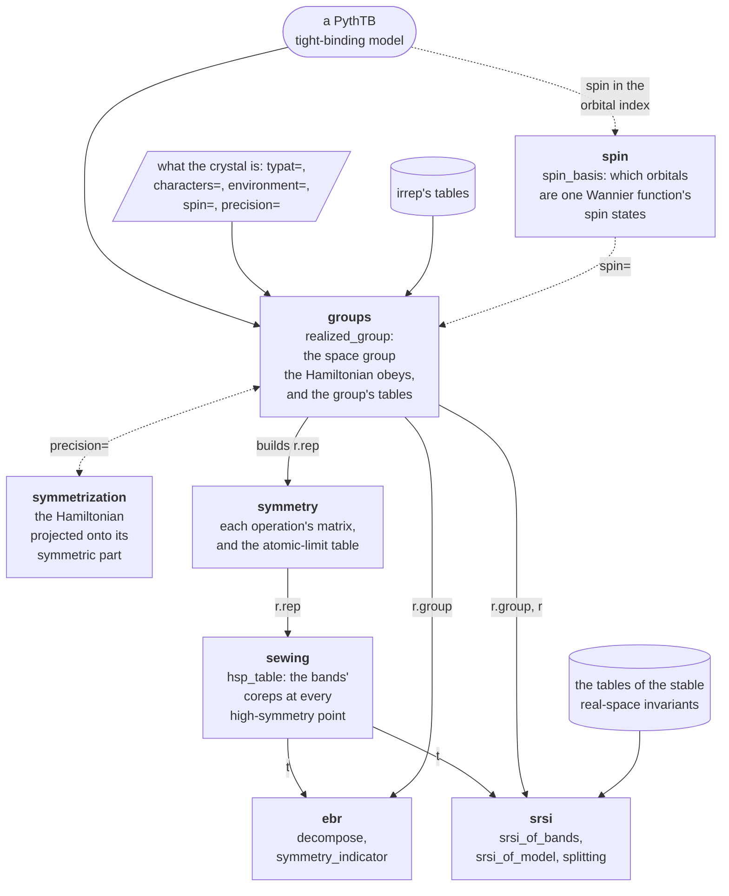
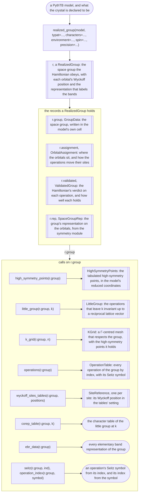
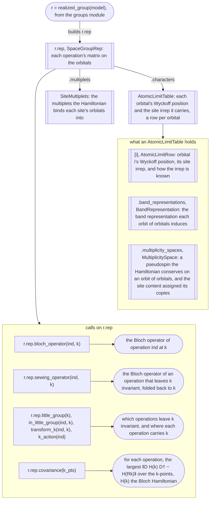
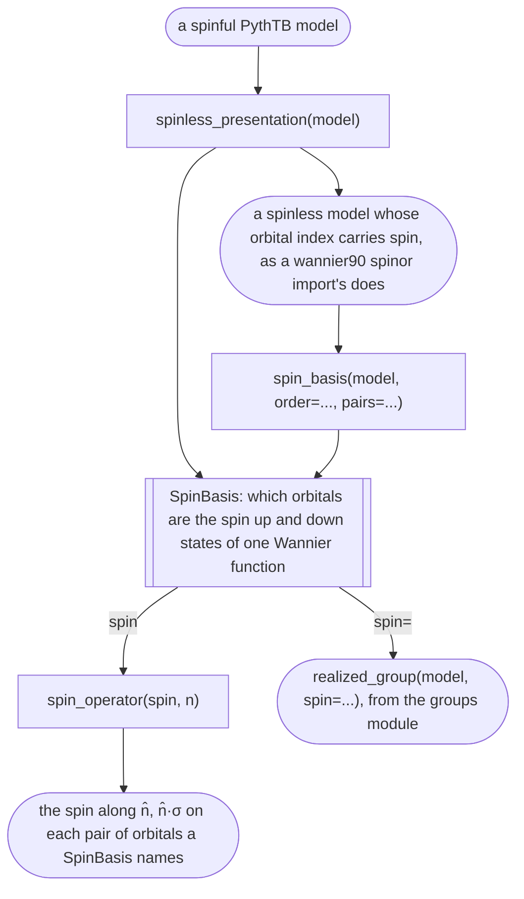
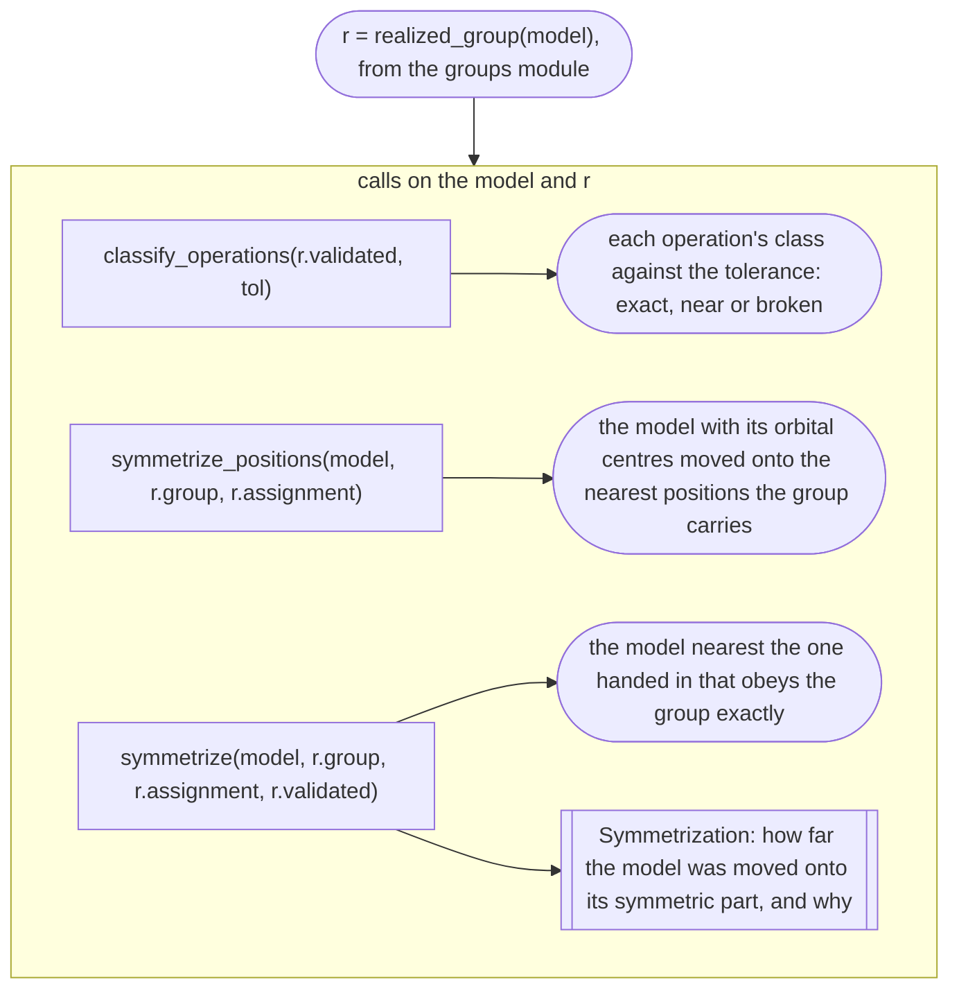
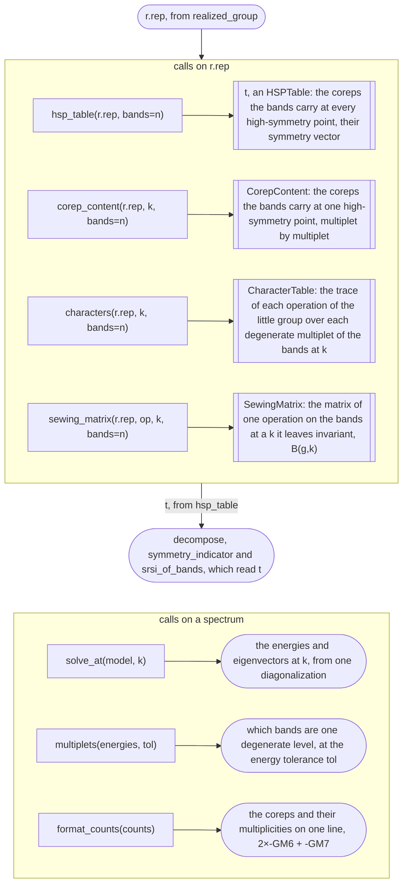
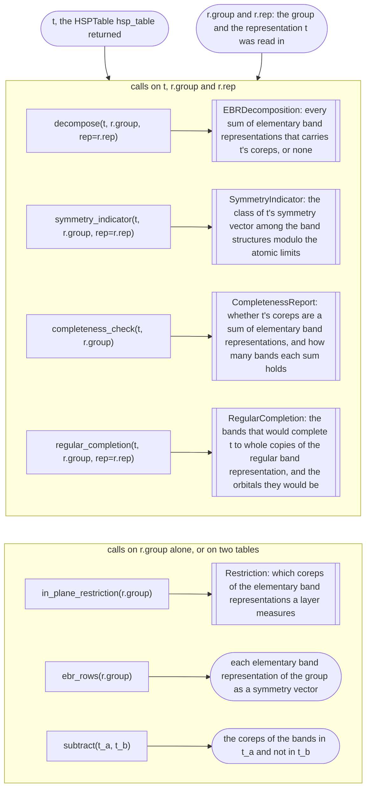
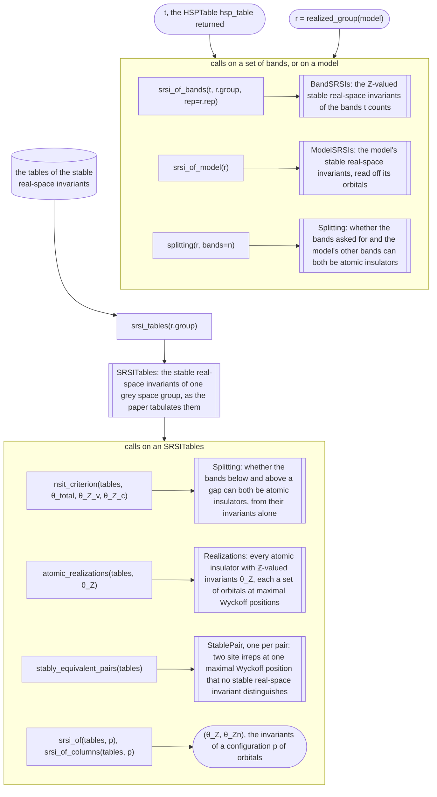

# How the modules fit together

The package is one path from a model to its invariants, and each step is one
module's. `realized_group` reads the space group the Hamiltonian obeys and builds
its representation; `hsp_table` reads the coreps a set of bands carries at every
high-symmetry point; and `decompose`, `symmetry_indicator` and the stable
real-space invariants read what that content says.

## The path a model takes

Each box is a module, with the calls it holds. Every call after `realized_group`
takes what it returned, `r`: `hsp_table(r.rep, bands=n)` returns the table `t` of
the bands' coreps, which `decompose`, `symmetry_indicator` and `srsi_of_bands`
each read with the group, as `decompose(t, r.group, rep=r.rep)`, and
`srsi_of_model(r)` and `splitting(r, bands=n)` take the record whole. The group's
own tables are read from `r.group`: `high_symmetry_points(r.group)`,
`little_group`, `k_grid`, `corep_table` and `ebr_data`.

A dotted arrow is a step `realized_group` takes where a declaration asks for it:
with `spin=`, it reads which orbitals of a wannier90 spinor import are the spin
states of one Wannier function; with `precision=`, it projects the Hamiltonian
onto its symmetric part, where an operation holds only within that precision.

## Module by module

Each chart is one module. A rectangle is a call it holds, a box with double
sides a record a call returns, and a rounded box anything else a call takes or
returns: a model, a plain value, or a record another module returned. An arrow
labelled with a field, such as `.group`, reads that field of the record. A call
that cannot complete returns a `Refusal` in its record's place, which the charts
leave out; every record is read field by field in the
[records reference](../reference/records.md).

### `groups`

The space group a Hamiltonian obeys, and that group's tables in the model's own
cell ([what group does my Hamiltonian have?](../guide/group.md)).

Two calls stand apart: `stack_presentation(model)` returns a layer repeated
along its normal with no hopping between the copies, a crystal with the layer's
bands at every `k_z`; and `tables_status()` says whether irrep's character tables
and ortools are installed.

### `symmetry`

The model's representation of its space group, and the atomic-limit table of its
orbitals ([how do I say what my orbitals are?](../guide/orbitals.md)).

### `spin`

The spin a spinless model carries in its orbital index, as a wannier90 spinor
import does ([how does pythtqc read the spin of my model?](../guide/spin.md)).

Given `spin="interleaved"`, `"blocked"` or the pairs, `realized_group` calls
`spin_basis` itself, and the representation keeps the basis on `r.rep.spin`.

### `symmetrization`

A model symmetric only to its declared precision, made exactly symmetric
([how do I measure a numerical or wannier90 model?](../guide/numerical.md)).

`realized_group` takes all three steps itself where `precision=` asks, and keeps
the centres' correction on `r.positions` and the projection on
`r.symmetrization`.

### `sewing`

The coreps a set of bands carries at the high-symmetry points, read off its
eigenvectors ([which coreps do these bands carry?](../guide/labels.md)).

An `HSPTable` holds the `CorepContent` read at each point on `.records`, and a
`CorepContent` the `CharacterTable` its labels were read from on `.table`.

### `ebr`

Whether a set of bands could be an atomic limit, and its symmetry-indicator class
([could these bands be an atomic limit?](../guide/atomic-limits.md),
[which symmetry-indicator class do these bands occupy?](../guide/indicators.md)).

`t` and `r.group` come from one `realized_group`: a table's labels name the
coreps of the group it was read in, and the table carries that representation as
`t.rep`, so a group or a `rep=` handed in beside it that is not the table's own
raises `ValueError`. `rep=r.rep` says how each site irrep is known
and, on a layer, which Wyckoff positions lie within it. An `EBRDecomposition` and
a `SymmetryIndicator` hold the `Restriction` they were read with on
`.restriction`, and a decomposition holds what it does not certify on `.caveat`,
a `WannierCaveat`.

### `srsi`

The stable real-space invariants: their tables, their values on a set of bands
and on a model, and the no-go criterion for a gapped splitting
([what do the stable real-space invariants say about these bands?](../guide/srsi.md)).

`nsit_criterion` is the test `splitting` makes, run on invariants already in
hand. A `Splitting` holds each side's `Realizations` on
`.realizations_v` and `.realizations_c`; a `BandSRSIs` the `SymmetryIndicator`
measured with it on `.indicator`; and a `ModelSRSIs` the `SRSITables` it was read
with on `.tables`.

## Beneath the path

Every module of the package, from the ground up: a module reads only the modules
above it in this table, the public ones among them.

| module | what it holds |
|---|---|
| `refusal` | `Refusal`, returned in place of a value a call cannot measure, and `InternalError`, raised where the package disagrees with itself |
| `_tolerance` | what a measurement judges noise against, resolved once |
| `_sitechars` | the characters of a site's symmetry group |
| `_bloch` | the Bloch Hamiltonian `H(k)`, summed from the model's hoppings |
| `spin` | which orbitals of a spinless model are one Wannier function's spin states, and the spin operator on them |
| `_text` | the words the records' printouts share: a coordinate, a k-point, a character, a count of operations, a sum of elementary band representations |
| `_spacegroup` | the space group of a cell, found on its point set and written in the model's own cell, with the records every measurement is written on |
| `_seitz` | each operation of a group by its index, with its Seitz symbol in the tables' setting and its name in the model's frame |
| `_tables` | irrep's tables in the model's own cell: the high-symmetry points, the little groups, the corep tables, the elementary band representations and the indicator group |
| `_subgroups` | the subgroups inside the operations the Hamiltonian keeps, and the tie rule that picks one where several of one order qualify |
| `_detector` | the eigen-sift detector: every matrix `X` with `X H(k) = H(Rk) X` on a grid of `k` |
| `_matrices` | the arithmetic of the operations' matrices: their composition, their phase, the Bloch operator, the members of a solution space inside given blocks |
| `_grammar` | the grammar of `characters=` and `multiplets=`, read where a call starts |
| `_centres` | the orbital centres against the group's action: where the operations put them, and how far they miss |
| `_naming` | site irreps named off the tables, each by the elementary band representation it induces |
| `symmetry` | the representation's records: each operation's matrix on the model's states, the atomic-limit table and each orbital's row |
| `_sectors` | the sectors the conserved matrices acting within sites split the states into |
| `_multiplets` | the multiplets the Hamiltonian binds each site's orbitals into, and the block of every operation on each |
| `_declaration` | what a declaration states, read on the measured multiplets, and the verdict per operation it gives |
| `_layers` | a layer's slab and its decoupled stack, the substrate under every site, and the check that the two environments agree |
| `sewing` | the coreps a set of bands carries at every high-symmetry point, read off its eigenvectors |
| `_smith` | the Smith normal form of the elementary band representations' matrix, and the compatibility relations read off it |
| `_srsitables` | the tables of the stable real-space invariants as shipped, and the paper's names for the symmetry indicators |
| `ebr` | whether a content could be an atomic limit, and its symmetry-indicator class |
| `srsi` | the stable real-space invariants of a set of bands and of a model, and the no-go criterion on a gapped splitting |
| `_labelling` | the labelling the Hamiltonian leaves open, chosen once by the lowest-angular-momentum rule, and the atomic-limit table read off it |
| `_measure` | `H(k)` on the detection grid and one solution space per k-action: the verdict on each operation of a group |
| `_build` | the representation, built once on what the verdict stage measured |
| `symmetrization` | a model symmetric only to its declared precision, made exactly symmetric |
| `_descent` | the unitary descent: one verdict per operation of the cell, and the cell lowered to the operations that hold |
| `_realized` | the space group a Hamiltonian obeys, measured round after round until it settles, and the record `realized_group` returns |
| `groups` | the space group a Hamiltonian obeys and the group's tables in the model's cell: `realized_group`, and the calls on `r.group` |
| `models` | the crystals the pages measure |
| `utils` | `save_figure`, which writes the examples' figures |

| outside the package | what it gives |
|---|---|
| `pythtb` | the models, and the hoppings the Bloch Hamiltonian is summed from |
| `irrep`, `irreptables` | the space groups, their coreps, their elementary band representations and their symmetry-indicator tables |
| `ortools` | the integer solver that finds every sum of elementary band representations |
| `spglib`, `sympy` | each site's Wyckoff letter, and the Wyckoff positions' coordinates read as expressions |
