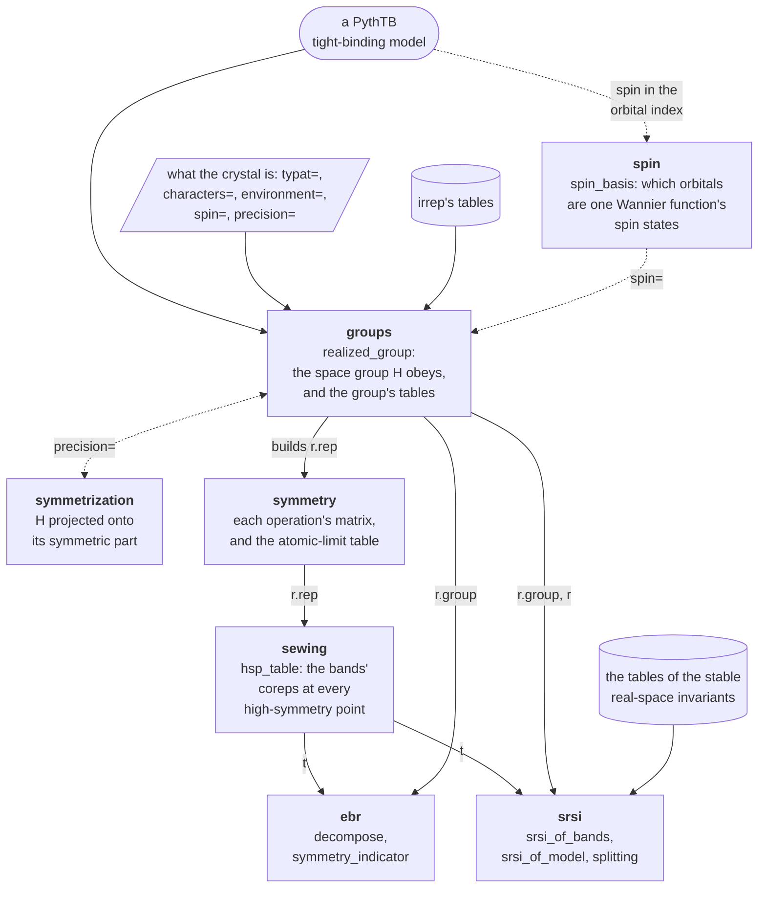

# How the modules fit together

The package is one path from a model to its invariants, and each step is one
module's. `realized_group` reads the space group the Hamiltonian obeys and builds
its representation; `hsp_table` reads the coreps a set of bands carries at every
high-symmetry point; and `decompose`, `symmetry_indicator` and the stable
real-space invariants read what that content says.

## The path a model takes

Each box is a module, with the calls it holds. Every call after `realized_group`
takes what it returned, `r`: `hsp_table(r.rep, bands=n)` returns the table `t` of
the bands' coreps, which `decompose`, `symmetry_indicator` and `srsi_of_bands`
each read with the group, as `decompose(t, r.group, rep=r.rep)`, and
`srsi_of_model(r)` and `splitting(r, bands=n)` take the record whole. The group's
own tables are read from `r.group`: `high_symmetry_points(r.group)`,
`little_group`, `k_grid`, `corep_table` and `ebr_data`.

A dotted arrow is a step `realized_group` takes where a declaration asks for it:
with `spin=`, it reads which orbitals of a wannier90 spinor import are the spin
states of one Wannier function; with `precision=`, it projects the Hamiltonian
onto its symmetric part, where an operation holds only within that precision.

## Beneath the path

| module | what it holds |
|---|---|
| `_bloch` | `H(k)`, summed from the model's hoppings |
| `_sitechars` | the characters of a site's symmetry group |
| `_sectors` | the sectors the conserved matrices acting within sites split the states into |
| `_tolerance` | what a measurement judges noise against, resolved once |
| `refusal` | `Refusal`, returned in place of a value a call cannot measure, and `InternalError`, raised where the package disagrees with itself |
| `models` | the crystals the pages measure |
| `utils` | `save_figure`, which writes the examples' figures |

| outside the package | what it gives |
|---|---|
| `pythtb` | the models, and the hoppings `H(k)` is summed from |
| `irrep`, `irreptables` | the space groups, their coreps, their elementary band representations and their symmetry-indicator tables |
| `ortools` | the integer solver that finds every sum of elementary band representations |
| `spglib`, `sympy` | each site's Wyckoff letter, and the Wyckoff positions' coordinates read as expressions |
