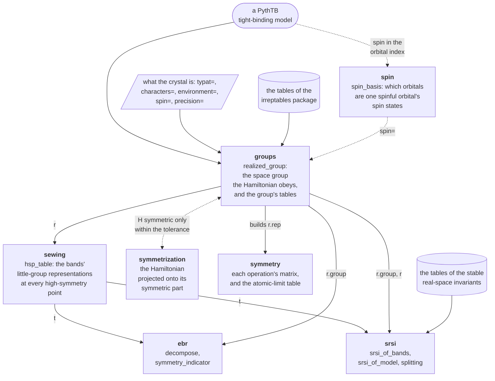
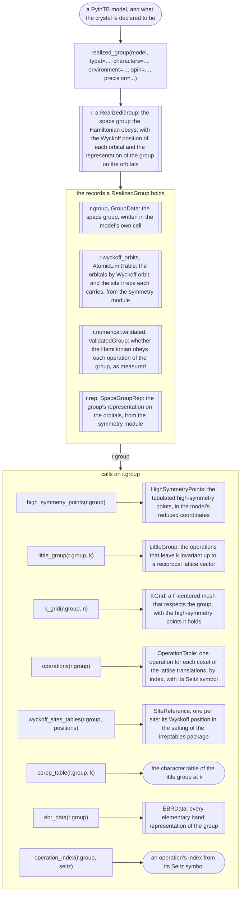
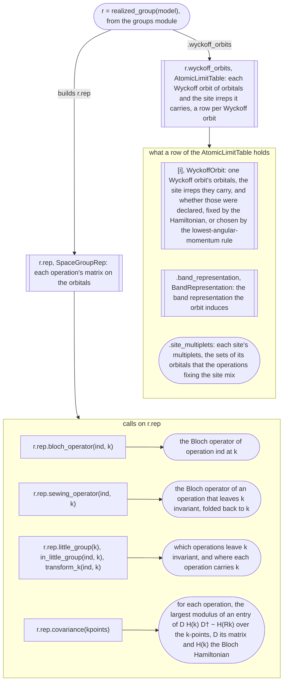
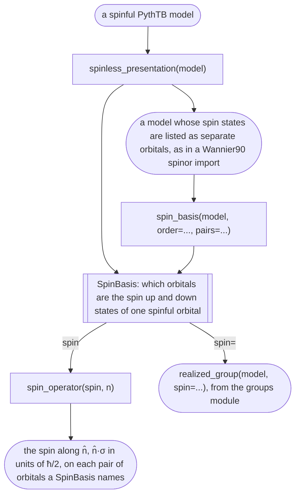
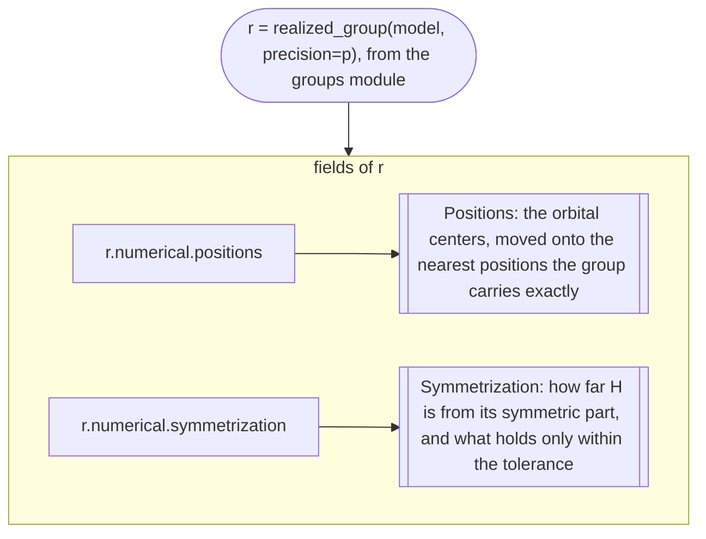
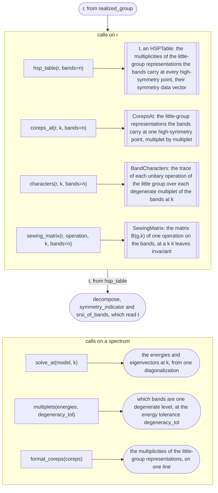
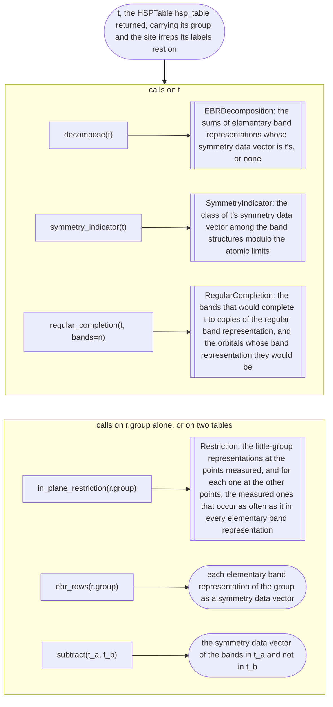
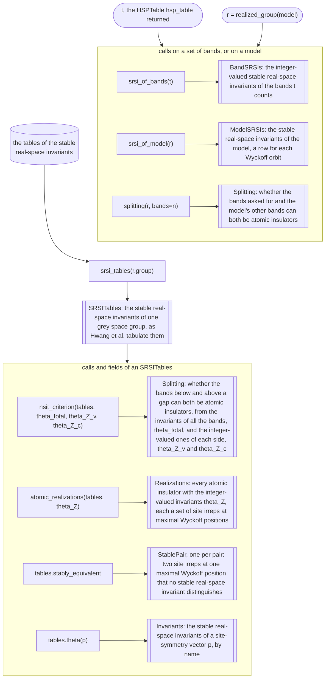

# How the modules fit together

pythTQC takes a model along one path, from its Hamiltonian to its invariants.
Each step is a call of one public module. `realized_group` returns the space
group the Hamiltonian obeys, with the representation of the group on the
orbitals. `hsp_table` returns the multiplicities of the little-group
representations a set of bands carries at every high-symmetry point, its
symmetry data vector. `decompose`, `symmetry_indicator` and `srsi_of_bands`
read that symmetry data vector. `srsi_of_model` reads the model's orbitals, and
`splitting` reads both.

## The path a model takes

Each box is a module, with the calls it holds. Each call after `realized_group`
takes what it returned, `r`, or a record read off it. `hsp_table(r, bands=n)`
returns `t`, the table of the little-group representations the bands carry.
`decompose(t)`, `symmetry_indicator(t)` and `srsi_of_bands(t)` take the table
alone, which carries its group. `srsi_of_model(r)` and `splitting(r, bands=n)`
take `r` whole. The tables of the group itself are read from `r.group`:
`high_symmetry_points(r.group)`, `little_group`, `k_grid`, `corep_table` and
`ebr_data`.

A dotted arrow is a step `realized_group` takes only where a declaration or the
model asks for it. With `spin=`, it reads which orbitals of a Wannier90 spinor
import are the spin states of one spinful orbital. `precision=` sets the
tolerance within which an operation is judged to hold, for a numerical model.
With no precision declared, the model is read as exact, and the tolerance is
`1e-8` times the largest entry of `H(k)`, the mean on-site energy subtracted.
Where the Hamiltonian is symmetric only within the tolerance, `realized_group`
projects it onto its symmetric part.

## Module by module

Each chart is one module. A rectangle is a call the module holds, or a field
read off a record. A box with double sides is a record a call returns. A
rounded box is anything else a call takes or returns: a model, a plain value,
or a record another module returned. A cylinder is a table the package ships or
reads. An arrow labeled with a field, such as `.wyckoff_orbits`, reads that
field of the record. A call that cannot complete returns a `Refusal` in place
of its record, and the charts leave it out. [Returned
records](../reference/records.md) lists the fields of every record.

### `groups`

The space group a Hamiltonian obeys, and the tables of that group, written in
the model's own cell, the one its pythtb Lattice specifies
([What group does my Hamiltonian have?](../guide/group.md)).

Two calls of the module stand apart from the path. `stack_presentation(model)`
returns a layer repeated along its normal with no hopping between the copies.
The stack is a crystal with the layer's bands at every `k_z`. `tables_status()`
says whether the character tables of the irreptables package are in place, and
whether ortools is installed.

### `symmetry`

The model's representation of its space group, and the atomic-limit table of
its orbitals ([How do I say what my orbitals are?](../guide/orbitals.md)).

### `spin`

The spin of a model whose spin states are listed as separate orbitals, as in a
Wannier90 spinor import
([How does pythTQC read the spin of my model?](../guide/spin.md)).

`spin=` takes `"interleaved"`, `"blocked"`, a mapping of the arguments of
`spin_basis`, or a `SpinBasis`. `realized_group` calls `spin_basis` itself
where it is not handed a `SpinBasis`, and keeps the basis on `r.spin`.

### `symmetrization`

A Hamiltonian symmetric only within the tolerance, projected onto its symmetric
part ([How do I measure a numerical or Wannier90
model?](../guide/numerical.md)).

`position_tol=` declares how far an orbital center may miss the position the
group puts it at and still be moved onto it, in reduced coordinates.
`realized_group` moves the orbital centers where `precision=` or
`position_tol=` is declared. It keeps the move on `r.numerical.positions`. It
projects the Hamiltonian onto its symmetric part where an operation or a site's
multiplet holds only within the tolerance, or where the hoppings couple
separate parts of the crystal or tell identical copies apart only below it. It
reports the projection on `r.numerical.symmetrization`. Each field is `None`
where its step was not taken.

### `sewing`

The little-group representations a set of bands carries at the high-symmetry
points, read off its eigenvectors
([Which little-group representations do these bands carry?](../guide/labels.md)).

`t.multiplets` holds, at each point, the rows `coreps_at` returns there: each
degenerate multiplet with the little-group representations it carries.

### `ebr`

Whether a set of bands could be an atomic limit, and its symmetry-indicator
class ([Could these bands be an atomic limit?](../guide/atomic-limits.md),
[Which symmetry-indicator class do these bands
occupy?](../guide/indicators.md)).

An HSPTable names the little-group representations of the group it was read
in. It carries that group as `t.group`, and the site irrep of each orbital with
whether each was declared, fixed by the Hamiltonian, or chosen by the
lowest-angular-momentum rule. The names of its little-group representations
depend on these site irreps. So each call on it takes the table alone. A
decomposition returns those site irreps with its sums. A table handed in with
`r` beside it raises `TypeError`. A symmetry data vector written out by hand is
passed with the `r` whose group names its labels:
`decompose(symmetry_data, r)`. For a layer, the table carries the orbitals'
heights, and a decomposition keeps only the elementary band representations
at Wyckoff positions within the layer. An `EBRDecomposition` and a
`SymmetryIndicator` hold the `Restriction` they were read with on
`.numerical.restriction`.

### `srsi`

The stable real-space invariants: their tables, their values on a set of bands
and on a model, and whether the bands on the two sides of a gap can both be
atomic insulators ([What do the stable real-space invariants say about these
bands?](../guide/srsi.md)). The invariants and their tables are those of
Hwang *et al.*, [*Stable real-space invariants and topology beyond symmetry
indicators*, Nat. Commun. **17**, 8564
(2026)](https://doi.org/10.1038/s41467-026-74844-w).

`nsit_criterion` is the test `splitting` makes, run on invariants already in
hand. A `Splitting` holds each side's `Realizations` on `.valence` and
`.conduction`. A `BandSRSIs` holds the `SymmetryIndicator` measured with it on
`.indicator`.

## Beneath the path

Every module of the package, public and private, from the ground up. When a
module is loaded, it imports only modules above it in this table.

| module | what it holds |
|---|---|
| `refusal` | `Refusal`, returned in place of a value a call cannot measure; `RefusalError`, a refusal raised as an exception by `Refusal.raise_()`; `InternalError`, raised where the package disagrees with itself; and `MagneticScopeWarning`, issued where time reversal is measured broken |
| `_tolerance` | what a measurement of crystalline symmetry judges noise against |
| `_sitechars` | the character table of a site's symmetry group, computed from the measured group, and the site irrep each orbital shorthand such as `px` carries |
| `_bloch` | `H(k)` of a tight-binding model, summed from the hoppings of each lattice vector |
| `spin` | the spin of a model whose spin states are listed as separate orbitals, as in a Wannier90 spinor import, and the spin operator on it |
| `_text` | the words the records' printouts share: a coordinate, a k-point, a character, a count of operations, a set of orbitals, and a sum of elementary band representations |
| `_spacegroup` | the space group of a cell, found from its positions and written in the model's own cell, with the records every later measurement is written on |
| `_seitz` | the operations of a group by index, each with its Seitz symbol, written in the conventional cell used by the irreptables package, and its name, written in the Cartesian axes in which the pythtb Lattice is specified |
| `_tables` | the tables of the irreptables package in the model's own cell: the high-symmetry points, the little group of a k-point, the character table of its little-group representations, the elementary band representations, the indicator group, and a mesh that respects the group |
| `_subgroups` | the subgroups of a group inside a set of its operations, and the tie rule that picks one where several of the largest order qualify |
| `_detector` | every matrix `X` with `X H(k) = H(Rk) X` on a grid of `k`, the candidates for an operation's matrix |
| `_matrices` | the arithmetic of the operations' matrices: their composition, their phase convention, the Bloch operator of an operation, and the irreducible representations of a group with a factor system |
| `_grammar` | the grammar of `characters=` and `site_multiplets=`, read where a call starts and before anything is measured |
| `_centers` | the orbital centers against the group's action on them: where the operations carry each site, how far the centers miss, and the least move onto positions the operations carry exactly |
| `_site_names` | site irreps named by the tables of the stable real-space invariants |
| `_naming` | site irreps named from the tables of the irreptables package, each by the elementary band representation it induces from its Wyckoff position |
| `symmetry` | the model's representation of its space group, and the atomic-limit table of its orbitals |
| `_sectors` | the sectors of the states, each a set of states the hoppings couple to nothing else, taken with its identical copies, read off the matrices that commute with `H(k)` at every `k` and act within sites |
| `_multiplets` | each site's multiplets, the sets of its orbitals that the operations fixing the site mix, and the block of every operation on each multiplet |
| `_declaration` | what a declaration states, read on the multiplets the Hamiltonian measures: each site's declared site irreps, and one verdict per operation |
| `_measure` | whether a Hamiltonian obeys each operation of a group, as measured |
| `_layers` | a layer's presentations, its slab and its decoupled stack; its two environments, on a substrate and free-standing; and the comparison of the groups the two give |
| `sewing` | the little-group representations a set of bands carries at the high-symmetry points, read off its eigenvectors |
| `_smith` | the integer arithmetic of a group's matrix of elementary band representations: its Smith normal form, and the compatibility relations |
| `_srsitables` | the tables of the stable real-space invariants of Hwang et al., as shipped, with the paper's names for the symmetry indicators |
| `ebr` | whether bands could be an atomic limit, and their symmetry-indicator class |
| `srsi` | the stable real-space invariants: the tables, their values on bands and models, and whether the bands on the two sides of a gap can both be atomic insulators |
| `_labeling` | the site irreps the Hamiltonian leaves open, chosen by the lowest-angular-momentum rule, and the atomic-limit table read off the choice |
| `_build` | the representation, built on what the measurement of each operation found: one matrix per operation on the model's states |
| `symmetrization` | a Hamiltonian symmetric only within the tolerance, projected onto its symmetric part |
| `_descent` | the group of the cell lowered to the group the Hamiltonian obeys |
| `_realized` | the space group a Hamiltonian obeys, and the record `realized_group` returns |
| `groups` | the space group a Hamiltonian obeys, and the tables of that group |
| `models` | tight-binding crystals to measure on, each chosen to make one question sharp |
| `utils` | `save_figure`, which writes the examples' figures so that a rerun writes the same file |

| outside the package | what it gives |
|---|---|
| `pythtb` | the models, and the hoppings `H(k)` is summed from |
| `irrep`, `irreptables` | the space groups, their little-group representations, their elementary band representations and their symmetry-indicator tables |
| `ortools` | the integer solver that finds every sum of elementary band representations |
| `spglib` | the space group of a cell from its positions, and each site's Wyckoff letter |
| `sympy` | the coordinates of the Wyckoff positions, read as expressions |
